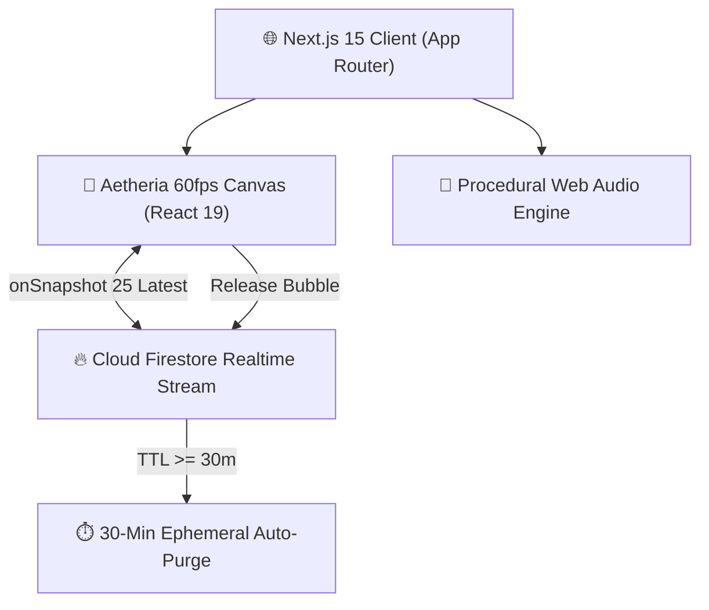

<div align="center">

# 🫧 AETHERIA
### *A Meditative, Ephemeral Canvas for Floating Thoughts & Shared Emotions*

[](https://nextjs.org/)
[](https://react.dev/)
[](https://www.typescriptlang.org/)
[](https://tailwindcss.com/)
[](https://firebase.google.com/)
[](LICENSE)

<br />

> *"A sanctuary in the noise of the internet. Release a quiet feeling, let it drift upon an iridescent breeze, and watch it dissolve gently into the ether."*

<br />

[Explore Features](#-features) • [Emotional Spectrum](#-the-emotional-spectrum) • [Quick Start](#-quick-start) • [Architecture](#-architecture) • [Security & TTL](#-ephemeral-lifecycle--security)

</div>

---

## ✨ Overview

**AETHERIA** is a real-time, zero-friction shared canvas where people across the globe release their thoughts into floating iridescent bubbles. There are no passwords, algorithms, or feeds—just pure, transient human expression drifting in procedural physics.

Every thought exists for **exactly 30 minutes**. As time passes, bubbles soften and shimmer until they gracefully dissolve into the atmosphere, leaving behind a clean, ever-renewing horizon.

---

## 🔮 Key Features

### 👤 Instant Name-First Access (No Auth Required)
- **Zero-Friction Onboarding:** No passwords or sign-in walls. Visitors simply enter their name or nickname upon arrival.
- **Personalized Handle:** Names are dynamically converted to custom handles (e.g., `Luna` $\rightarrow$ `@luna`) displayed below each bubble.
- **Local Persistence & Quick Edit:** Stored in local storage so you can freely change your name anytime with one click in the header.

### 🫧 3D Iridescent Soap-Bubble Physics
- **Procedural Canvas Simulation:** 60fps requestAnimationFrame physics engine simulating natural buoyancy, horizontal sinusoidal sway, and elliptical collision repulsion.
- **Tactile Popping Experience:** Hovering slows and magnifies bubbles; clicking pops them into multi-colored water droplet bursts with custom physics particle scattering.
- **Fluid & Responsive:** Dynamically scales density and bubble sizes across mobile phones, tablets, and ultra-wide desktop displays.

### ⏳ Ephemeral 30-Minute Lifecycle
- **Automatic Fading:** Each thought has an exact 30-minute time-to-live (TTL).
- **Live Ephemeral Countdown:** Frosted tags underneath bubbles show real-time remaining minutes (`24m left`).
- **Dissolving Shimmer:** When under 3 minutes remain, bubbles pulse softly to notify visitors that they are dissolving into the ether.
- **Automated Firestore Purge:** Expired bubbles are automatically pruned and deleted from Cloud Firestore.

### 💖 Community Warmth Reactions
- **Send Warmth (`+1 ✨`):** Tap the warmth button on any revealed thought to send anonymous positive energy.
- **One-Way Atomic Increments:** Guaranteed atomic updates via Firestore's `increment(1)` field transform with strict immutable rules.

### 🎶 Procedural Web Audio Soundscape
- **Interactive Audio Feedback:** Pure synthesized sound effects via Web Audio API—subtle hover tones, soft bubble pops, release chimes, and warmth sparkles.
- **Accessible & Muteable:** Quick frosted sound toggle in the top navigation bar with auto-saved sound preferences.

---

## 🌈 The Emotional Spectrum

Every thought bubble reflects its author's state of mind through distinct iridescence, outer halos, and chromatic rim lighting:

| Emotion | Tint | Aura Hex | Meaning & Energy |
| :--- | :---: | :---: | :--- |
| **Calm** | 🟣 Lavender | `#A78BFA` | Quiet contemplation, tea on rainy mornings, peaceful solitude |
| **Joy** | 🟡 Warm Amber | `#FBBF24` | Bursting happiness, serendipitous smiles, small victories |
| **Peace** | 🟢 Emerald Mint | `#34D399` | Dropping your shoulders, deep breaths, grounded tranquility |
| **Melancholy** | 🔵 Soft Azure | `#60A5FA` | Nostalgia, longing for old summers, gentle reflective sorrow |
| **Hope** | 🌸 Radiant Rose | `#F472B6` | Sunlight after rain, quiet beginnings, faith in tomorrow |

---

## 🛠️ Architecture & Tech Stack



- **Frontend Core:** [Next.js 15](https://nextjs.org/) (App Router), [React 19](https://react.dev/), [TypeScript 5](https://www.typescriptlang.org/)
- **Visuals & Motion:** [Tailwind CSS v4](https://tailwindcss.com/), [Motion (Framer Motion)](https://motion.dev/), Lucide Icons
- **Backend & Database:** [Firebase Cloud Firestore](https://firebase.google.com/docs/firestore) Realtime Database
- **Hosting & Static Export:** [Firebase Hosting](https://firebase.google.com/docs/hosting) & Next.js Static Export (`out/`)
- **Sound Design:** Procedural Audio Synthesis via native browser `AudioContext`

---

## 🚀 Quick Start

### 1. Clone the Repository
```bash
git clone https://github.com/Cody-Abhi/AETHERIA.git
cd aetheria
```

### 2. Install Dependencies
```bash
npm install
```

### 3. Setup Firebase Configuration
Configure your environment variables in `.env.local` (or customize `firebase-applet-config.json`):

```env
NEXT_PUBLIC_FIREBASE_API_KEY="your-api-key"
NEXT_PUBLIC_FIREBASE_AUTH_DOMAIN="your-app.firebaseapp.com"
NEXT_PUBLIC_FIREBASE_PROJECT_ID="your-project-id"
NEXT_PUBLIC_FIREBASE_STORAGE_BUCKET="your-app.firebasestorage.app"
NEXT_PUBLIC_FIREBASE_MESSAGING_SENDER_ID="your-sender-id"
NEXT_PUBLIC_FIREBASE_APP_ID="your-app-id"
```

### 4. Run Development Server
```bash
npm run dev
```
Open **[http://localhost:3000](http://localhost:3000)** in your browser to enter the sanctuary.

---

## 📦 Production Build & Deployment

### Build for Firebase Hosting
Generate the optimized static export files in the `out/` directory:
```bash
npm run build:hosting
```

### Deploy to Firebase
Deploy the latest security rules and hosting build:
```bash
# Deploy Firestore security rules with 30m TTL support
npx firebase deploy --only firestore:rules

# Deploy static web assets to Firebase Hosting
npm run deploy:hosting
```

---

## 🔒 Ephemeral Lifecycle & Security

Security rules strictly enforce the schema, character caps, and the 30-minute lifespan:

```firestore
// Ephemeral lifecycle: messages expire and are purged under 30 minutes
allow delete: if isValidId(bubbleId)
  && resource.data.createdAt is timestamp
  && request.time >= resource.data.createdAt + duration.value(25, 'm');
```

- **Payload Integrity:** Enforces length constraints (thoughts capped at 140 characters, usernames at 24).
- **Daily Reflection Cap:** Mindful quota of up to 5 thoughts released per calendar day.
- **Warmth Protection:** Updates are locked solely to incrementing the warmth counter by $+1$; all other fields are strictly immutable.

---

## 📄 License

Distributed under the **MIT License**. See `LICENSE` for more information.

---

<div align="center">
  <sub>Crafted with tranquility, iridescence, and code.</sub>
</div>
